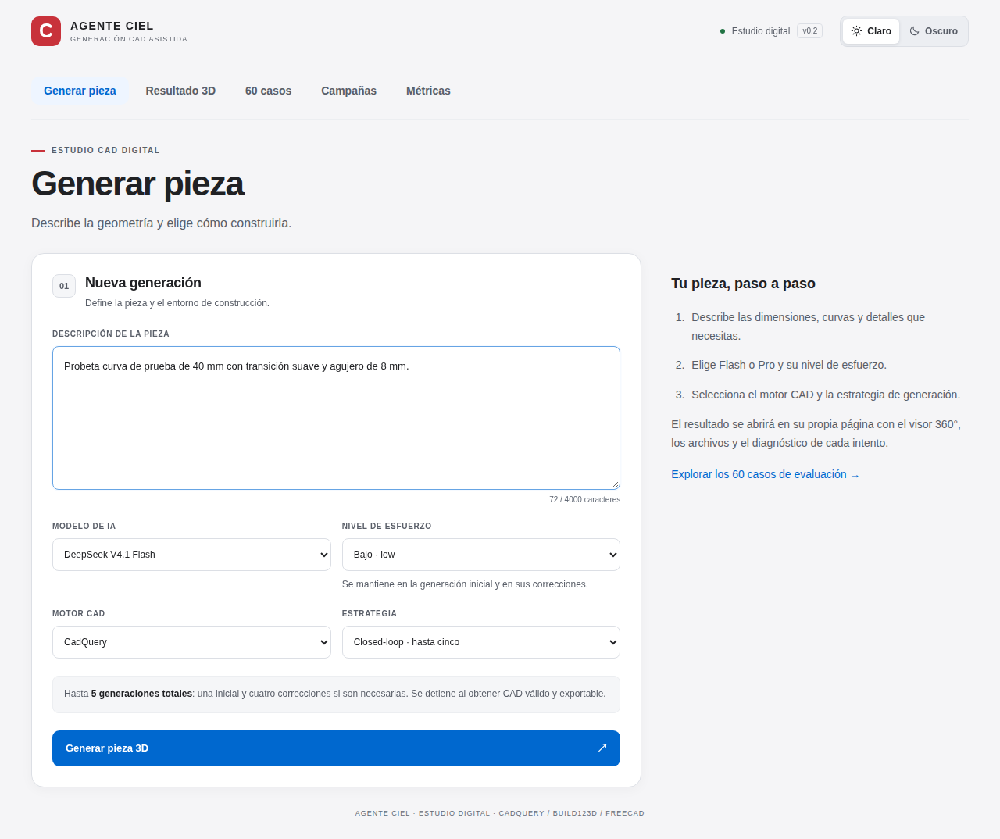
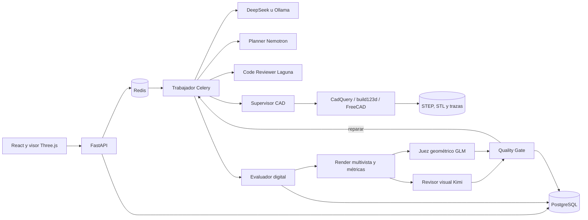

# Agente Ciel

**Generación de modelos CAD desde descripciones en español y evaluación digital reproducible.** El sistema consulta un modelo de IA, ejecuta el programa CAD en un contenedor aislado, valida los archivos y conserva la evidencia de cada intento. Está orientado al estudio descrito en el [artículo](Articulo-CADIALLM-V2.pdf) y sus [requisitos de resultados](Requisitos_Resultados-CADLLMIA.pdf).



## Qué permite hacer

- **Generar piezas** con CadQuery, build123d o FreeCAD Python API y descargar STEP y STL; FreeCAD también entrega FCStd.
- **Elegir IA:** DeepSeek Flash o Pro mediante API, con esfuerzo bajo, alto o máximo. También hay perfiles Ollama para Qwen 3.5 (0,8B y 2B), Gemma 3 4B, Ministral 3 3B y SmolLM3 3B; se habilitan al configurar sus etiquetas y el trabajador verifica disponibilidad y cuantización antes de ejecutarlos.
- **Corregir errores:** en *closed-loop* se envían a la IA el programa anterior y los diagnósticos, hasta cinco intentos en total. *Open-loop* realiza uno. La ejecución termina cuando obtiene CAD válido y exportable.
- **Quality Loop experimental:** plan geométrico validado, revisión estática con Laguna, ejecución CAD aislada, medición determinista y revisiones geométrica y multivista; repara hasta tres ciclos. NVIDIA NIM asigna un modelo a cada rol y conserva separados el éxito técnico y la aceptación de calidad. Best-of-N genera y compara hasta tres candidatos cuando se activa.
- **Inspeccionar resultados:** visor 3D giratorio, historial de intentos, diagnósticos, archivos y trazas.
- **Comparar experimentos:** 60 prompts congelados —20 básicos, 20 intermedios y 20 complejos—, campañas con ambos modos y los tres motores, métricas digitales y exportaciones CSV/JSON. Las comparaciones IoU y Chamfer requieren una referencia STEP independiente.

## Programa libre para Windows

La [edición libre](edicion-libre/README.md) se conserva por separado en `edicion-libre/`, con [su propio historial de versiones](edicion-libre/CHANGELOG.md) y etiquetas `libre-v<versión>`. Incluye el [instalador nativo 0.5.0](edicion-libre/entregas/0.5.0/Agente-Ciel-Nativo-0.5.0-Setup.exe), código, instrucciones y hashes. Usa cinco modelos de Ollama y conserva el lote de 45 prompts, resultados y exportaciones. Su ejecución real debe comprobarse en Windows; la aplicación de pago de esta raíz tiene su propio despliegue.

## Inicio rápido

Necesitas Docker Engine con Docker Compose y una clave de DeepSeek para usar los modelos habilitados por defecto. Desde la raíz del repositorio:

1. Crea un archivo de entorno **fuera del repositorio**, por ejemplo `/tmp/agente-ciel.env`, con `DEEPSEEK_API_KEY=tu_clave`. Protégelo con `chmod 600 /tmp/agente-ciel.env`.
2. Construye las imágenes y levanta los servicios:

   ```bash
   docker compose --env-file /tmp/agente-ciel.env --profile imagenes build
   docker compose --env-file /tmp/agente-ciel.env up -d
   ```

3. Abre [http://127.0.0.1:8000](http://127.0.0.1:8000). Comprueba el servicio con `curl -fsS http://127.0.0.1:8000/api/salud`.

La interfaz separa **Generar pieza**, **Resultado 3D**, **60 casos**, **Campañas** y **Métricas**. Para una primera prueba, describe una pieza, selecciona modelo, esfuerzo, motor y estrategia, y pulsa **Generar pieza 3D**. La vista previa de una campaña calcula la matriz sin iniciarla; **Iniciar campaña** sí programa llamadas a la IA y puede generar costos. El [manual de la aplicación](README_APLICACION.md) explica configuración local con Ollama, presupuestos, controles de campaña y exportaciones.

## Arquitectura y organización



El código se reparte entre `aplicacion/` (API, generación, campañas y métricas), `aplicacion/calidad/` (plan geométrico, routing NIM, prompts por rol y Quality Gate), `interfaz/src/` (páginas y visor), `motores/` y `supervisor/` (ejecución CAD), `evaluador/` (análisis geométrico y renders reproducibles), `datos/` (conjunto versionado) y `pruebas/` (pruebas y fixtures). PostgreSQL, Redis y los artefactos usan volúmenes de Docker.

La [auditoría del prompt maestro](AUDITORIA_PROMPT_MAESTRO.md) relaciona cada requisito con su hito, evidencia y límites pendientes.

Quality Loop requiere `NVIDIA_API_KEY` en un archivo de entorno externo; no bloquea el arranque si falta y el resto de modos sigue disponible. Puede añadirse, por ejemplo, `NVIDIA_API_KEY=...` a `/tmp/agente-ciel.env`, proteger el archivo con `chmod 600` y recrear API y trabajador. La clave solo llega a esos servicios. La revisión de referencias se mantiene apagada salvo que se active explícitamente `QUALITY_ALLOW_REFERENCE_METRICS=1`; ese protocolo debe informarse por separado.

## Pruebas y desarrollo

Las pruebas de la aplicación simulan las llamadas pagadas. Ejecuta cada conjunto en la imagen que contiene sus dependencias:

```bash
docker run --rm --network agente-ciel_default -v "$PWD:/servicio:ro" ciel-aplicacion:piloto python -m unittest discover -s pruebas -v
docker run --rm -v "$PWD:/servicio:ro" ciel-evaluador:piloto python -m unittest discover -s pruebas -p test_evaluador.py -v
```

Para comprobar la compilación de la interfaz: `npm --prefix interfaz ci` y `npm --prefix interfaz run construir`. Consulta [AGENTS.md](AGENTS.md) antes de contribuir.

## Alcance y evidencia

Este repositorio cubre **generación y evaluación digital**; la impresión y el escaneo 3D quedan fuera del programa. Un CAD exportable no demuestra por sí solo semejanza visual ni fidelidad arqueológica. El [piloto B01](VERIFICACION_PILOTO_RESULTADOS.md) prueba la integración de 12 condiciones de un caso básico; sus resultados no representan la evaluación completa de los 60 prompts. El [plan técnico](PLAN_TECNICO_AGENTE_CIEL.md) detalla hitos y protocolo.

La API se publica solo en `127.0.0.1`; evita exponerla sin autenticación. No incluyas claves en commits ni exportaciones. El supervisor tiene acceso al socket de Docker y debe ejecutarse en un equipo controlado.
